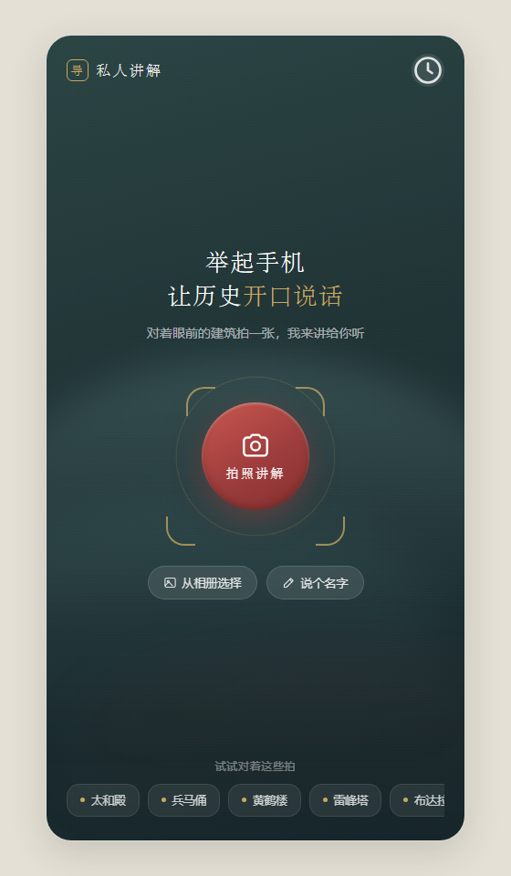
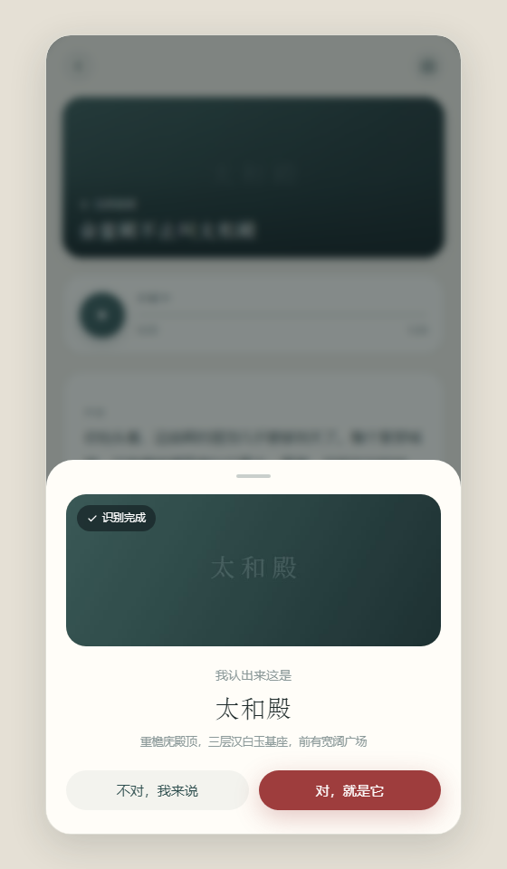
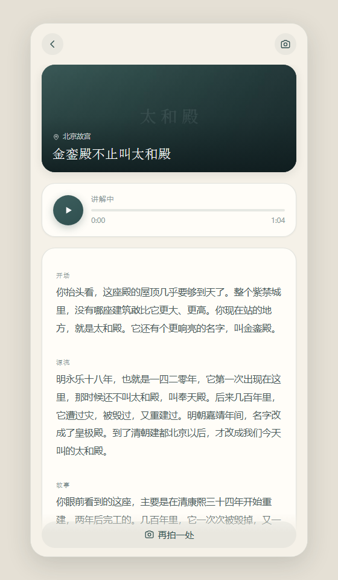
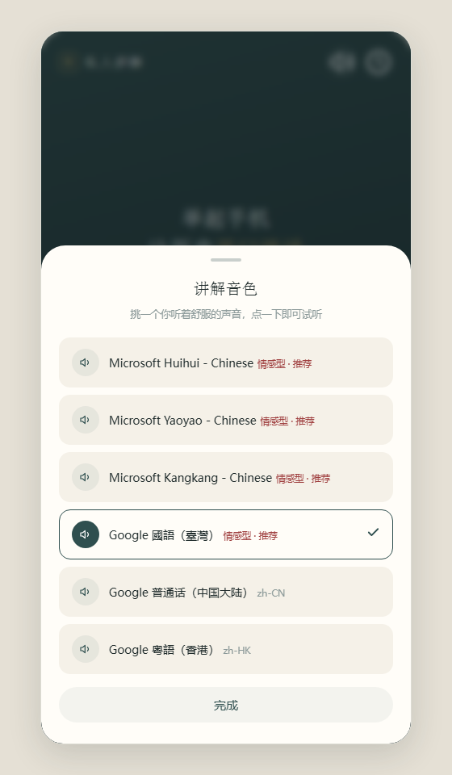
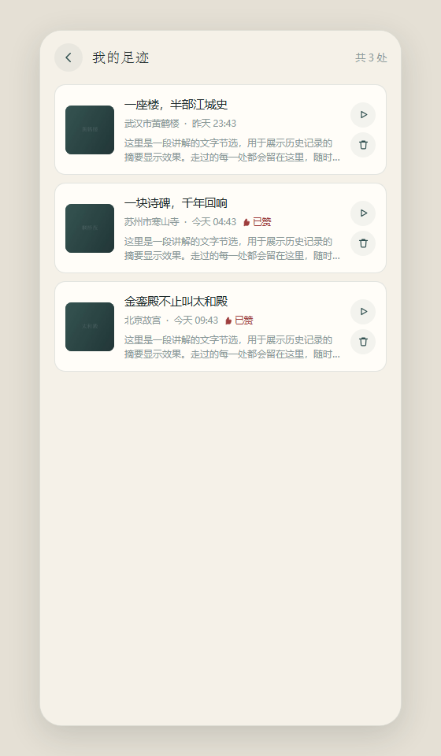

<div align="center">

# 私人 AI 导游 · Private Guide

**走到哪儿，讲到哪儿。拍一张照，听一段有据可查的讲解。**

[](../../releases)
[](https://developer.android.com)
[](https://capacitorjs.com)
[](LICENSE)

</div>

---

## 这是什么

一个**给自己用的私人 AI 导游**。站在古建筑、文物、景点面前，拍张照，App 会识别这是什么、位于哪个景区，然后生成一段可以边走边听的讲解——而且**每段讲解都能溯源**，不许瞎编。

不需要电脑，不需要服务器。AI 调用和语音合成都由手机直接完成，装完填一次自己的 API 密钥就能长期使用。

## 核心特性

| 特性 | 说明 |
|---|---|
| 📷 **拍照即讲** | 拍建筑、文物、说明牌 → 视觉模型识别 → 确认点位 → 生成讲解 → 自动播放 |
| 🔍 **三层真实性约束** | Prompt 硬约束 + 真实资料溯源 + 冲突降级，杜绝编造 |
| 🗣️ **高清神经音色** | 微软 Edge 神经音色（晓晓/云希/云健等），原生通道合成，接近真人 |
| ⚡ **试听免等待** | 打开音色面板即后台预热全部音色，切换试听基本秒出声 |
| 📍 **附近探索** | 讲解结束推荐周边点位，可持续逛下去 |
| 🕘 **我的足迹** | 完整历史记录，可重听、可删除 |
| 🔒 **密钥不出手机** | API 密钥只存本机，不上传任何服务器 |

## 截图

<div align="center">

| 首页 | 识别确认 | 讲解页 |
|:---:|:---:|:---:|
|  |  |  |

| 音色设置 | 我的足迹 |
|:---:|:---:|
|  |  |

</div>

## 快速开始

### 方式一：直接装 APK（推荐）

1. 从 [Releases](../../releases) 下载 `私人导游-vX.Y.Z-直连版.apk`
2. 传到安卓手机安装（提示"未知来源"允许即可）
3. 打开 App → 首页右上角**齿轮** → 选服务商 → 填自己的 **API 密钥** → 测试连接 → 保存

> 密钥在服务商后台的「API Keys」页面生成，一般以 `sk-` 开头。

### 方式二：从源码构建

**环境要求**：Node.js 18+、JDK 17、Android SDK（`ANDROID_HOME` 已配置）

```bash
# 1. 克隆
git clone https://github.com/<你的用户名>/private-guide-app.git
cd private-guide-app

# 2. 同步 Web 资源到安卓工程
cd app
node update-version.js 2.2.4 11   # 版本号 versionCode
node sync-www.js                  # web/ → www/

# 3. 编译
cd android
./gradlew.bat assembleDebug       # Windows
# ./gradlew assembleDebug         # macOS / Linux

# 产物：app/android/app/build/outputs/apk/debug/app-debug.apk
```

### 方式三：本地 Web 调试（可选）

早期版本带一个本地中转服务，可以在浏览器里调 UI：

```bash
cd server
npm install
cp .env.example .env      # 填入自己的密钥
node index.js
# 浏览器打开 http://localhost:3000
```

调试参数：`?demo=1`（免 API 渲染讲解页）、`?demo=1&view=voice`（音色面板）、`?demo=1&noimg=1`（无照片占位图）。

## 项目结构

```
private-guide-app/
├── web/                        前端源码（无框架，原生三件套）
│   ├── index.html              单页结构：首页 / 确认 / 讲解 / 足迹
│   ├── env.js                  打包时内置默认值（密钥留空）
│   ├── styles/
│   │   ├── theme.css           设计变量（配色 / 圆角 / 字体）
│   │   └── main.css            页面样式
│   └── scripts/
│       ├── app.js              主流程与 UI 渲染
│       ├── engine.js           讲解生成编排（识别→检索→生成→归一化）
│       ├── api.js              模型接口调用（直连 / 中转双模式）
│       ├── config.js           服务商预设与密钥管理
│       ├── speech.js           逐句播报 + 高亮 + 预取预热
│       ├── edge-tts.js         Edge TTS 合成（WebSocket / 原生桥）
│       └── storage.js          历史记录（localStorage）
│
├── app/                        Capacitor 安卓壳
│   ├── android/                原生工程
│   │   └── app/src/main/java/com/privatetour/guide/
│   │       ├── MainActivity.java      入口，持有 TTS 桥
│   │       └── EdgeTtsBridge.java     JS ↔ 原生桥：Edge TTS + 系统 TTS
│   ├── sync-www.js             web/ → www/ 同步脚本
│   └── update-version.js       版本号写入脚本
│
├── server/                     本地中转服务（可选，早期 Web 阶段用）
│   ├── index.js                路由：/api/recognize /api/guide /api/tts
│   ├── .env.example            配置模板（真实 .env 已忽略）
│   └── services/               识别 / 检索 / 讲解 / TTS
│
├── docs/                       需求文档、配置指南、截图
└── dist/                       分发包（APK 已忽略，仅留说明）
```

## 技术要点

**为什么直连能跑通** — 通过 Capacitor 的 `CapacitorHttp` 插件绕过 WebView 的 CORS 限制，手机直接调用 OpenAI 兼容接口；Edge TTS 则通过原生 Java 桥（OkHttp WebSocket）合成，避开浏览器环境限制。

**真实性怎么保证** — 讲解生成有三档降级策略：

- `direct`：点位有百科词条 → 纯资料生成
- `parent`：点位无词条但有上级景区资料 / 现场说明牌 → 景区资料 + 模型可靠知识（来源区如实标注）
- `none`：无任何资料 → 诚实兜底话术，不硬编

**语音为什么快** — 音色面板一渲染就后台串行预热所有音色的试听音频，缓存按音色命名空间隔离，切音色命中缓存直接播放；同时用 token 世代计数器解决异步竞态（切换 / 停止 / 降级时的过期回调）。

## 已知限制

- **Edge TTS 无商业授权** — 仅适合个人自用。若要上架应用商店，需替换为有商业授权的云 TTS（阿里云 / 腾讯云 / 火山引擎），并把播放迁移到原生前台服务以实现锁屏后台播放
- Debug 签名，仅供自用与朋友安装，未上架商店
- 生成讲解约需 8–20 秒（含资料检索 + 生成）
- 语音缓存与历史记录存于本机，卸载即清空

## 文档

| 文档 | 说明 |
|---|---|
| [需求开发文档](docs/需求开发文档.md) | 唯一权威开发依据 |
| [需求确认文档](docs/需求确认文档.md) | 需求确认记录 |
| [API 密钥与配置更换指南](docs/API密钥与配置更换指南.md) | 换密钥 / 换服务商 / 换模型 |
| [使用说明](dist/使用说明.md) | 面向安装用户的说明 |

## 免责声明

本项目仅用于个人学习与自用。识别与讲解内容由 AI 生成，**可能存在错误**，请勿作为专业导游或学术引用的依据。使用第三方 API 与 Edge TTS 时请遵守其各自的服务条款。

## License

[MIT](LICENSE)
